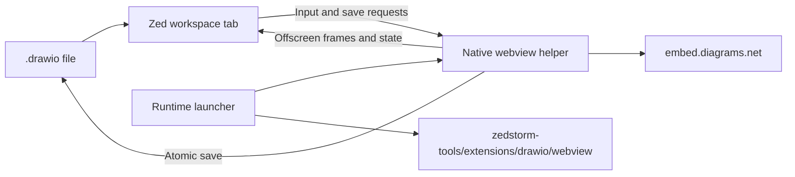

# diagrams.net for ZedStorm

Opening a `.drawio` file opens an interactive diagrams.net workspace tab on Linux,
including Wayland. The editor lives inside Zed's pane and resizes with it. Pointer,
keyboard, dragging, and scrolling events are forwarded to the operating system's
WebKitGTK webview. Save writes the local file; unsaved edits mark the tab dirty and
use Zed's normal save/discard prompt when closing.

No browser is bundled. The native runtime runs outside the main Zed process and
supplies an offscreen surface which GPUI paints inside the tab. This avoids adding
GTK or WebKit libraries to Zed's own startup dependencies. Inactive tabs pause frame
capture, and closing a tab releases its process and GPU image resources.

## Build and install

Install Rust and Python 3, plus Flatpak or the WebKitGTK 4.1 development packages.
From the repository root:

```sh
python3 extensions/drawio/install.py
cargo build -p zed
```

Run the rebuilt ZedStorm and open a `.drawio` file. Host support is included in this
fork; this extension cannot provide embedded tabs in an unmodified upstream Zed.
The optional language extension can be loaded via **Install Dev Extension** using
this directory. It associates `.drawio` files with the Draw.io language.

The installer builds the helper into:

```text
<Zed data directory>/zedstorm-tools/extensions/drawio/
├── bin/
│   ├── zed-diagrams
│   └── zed-diagrams-webview
└── webview/
    └── flatpak/ # Downloaded Linux runtime and build SDK
```

On Linux the default directory is
`~/.local/share/zed/zedstorm-tools/extensions/drawio`.
Set `ZEDSTORM_TOOLS_DIR` to override the shared tools directory. The host passes its
actual Zed data directory to the launcher, including when using `--user-data-dir`.
Use `ZED_DATA_DIR` when installing tools for a custom data directory.

The launcher uses system WebKitGTK when available. Otherwise it downloads the
signed GNOME 50 runtime through Flatpak, setting `FLATPAK_USER_DIR` to the managed
`webview/flatpak` directory. Without development packages, the installer also
downloads the matching build SDK. Downloads can be large and are reused.

## Usage and limits

Open an existing `.drawio` file from the project panel or file picker. To create a
diagram, create an empty file with the `.drawio` suffix, open it, add shapes, and
select Save. Use the editor's Save button or Zed's save command. External file edits
block saving to prevent replacement of those edits. Reopen the diagram to reload it.

The online editor needs internet access. Embedded PNG/SVG diagrams and remote
projects are not supported. The embedded tab currently supports Linux; Windows and
macOS still open `.drawio` files as text. The helper retains a standalone mode for
development, using WKWebView on macOS and WebView2 on Windows. The Windows launcher
can download a fixed WebView2 runtime into the same managed extension directory.

Frames are currently captured at up to ten frames per second. This integration
forwards pointer and keyboard events; native webview accessibility and IME
composition are not bridged into GPUI yet.

## Architecture decision

Wry cannot directly attach a GTK webview to GPUI's Wayland window. Zed therefore
owns a normal workspace item while the helper owns a GTK offscreen window. The
WebKit surface is streamed over stdout as bounded frames; input and save requests
travel over stdin. Blocking GTK work stays outside GPUI's foreground thread.
The host decodes images on the background executor and releases replaced images
from the GPU atlas. The local host page uses the
[diagrams.net embed protocol](https://www.drawio.com/docs/reference/embed-mode/),
checking origin, source window, and a per-session IPC token.



## Verification

```sh
cargo check -p image_viewer
cargo test --manifest-path extensions/drawio/Cargo.toml -p zed-diagrams --no-default-features --locked
node --test extensions/drawio/native/tests/bridge.test.cjs
```

For Linux helper builds and lint checks without host WebKitGTK headers, use the
installed GNOME SDK with `FLATPAK_USER_DIR` pointing at the managed runtime directory.
