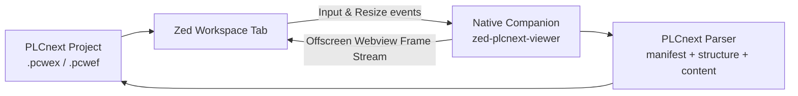

# PLCnext Engineer Project Viewer for ZedStorm

Read-only viewer and explorer for Phoenix Contact PLCnext Engineer projects (`.pcwex`, `.pcweax`, `.pcwlx`, `.pcwef`).

Inspect project hierarchies, IEC 61131-3 logic worksheets, variables, ESM tasks, and hardware bus topologies directly inside an embedded Zed tab—without needing the proprietary Phoenix Contact PLCnext Engineer desktop suite installed.

## Features

- **Direct File Format Support**:
  - `.pcwex` (standard compressed PLCnext project archive)
  - `.pcweax` (project archive with bundled libraries)
  - `.pcwlx` (PLCnext library container)
  - `.pcwef` (uncompressed flat project folder / VCS solutions)
- **Phoenix Contact Industrial Engineering Interface**:
  - **Project Overview**: Controller target (e.g. AXC F 1152, AXC F 2152, AXC F 3152, RFC 4072S), firmware versions, schema IDs, and metadata.
  - **ESM Scheduler**: Execution & Synchronization Manager tasks, cycle times (e.g. `T#20ms`), priorities, watchdogs, and assigned program instances.
  - **POU Explorer**: Programs, Function Blocks, and Functions.
  - **IEC 61131-3 Code Viewer**: Syntax-highlighted Structured Text (`.st`) and rendered Ladder / FBD network logic.
  - **Variable Tables**: Variable scopes (`VAR_INPUT`, `VAR_OUTPUT`, `VAR_IN_OUT`, `VAR_GLOBAL`, `VAR`), GDS port flags, retain/constant attributes, and comments.
  - **Data Types (UDTs)**: Formatted struct and enum definitions.
  - **Hardware Rack Visualizer**: Axioline F / bus module configuration, slot numbers, order numbers, and mapped process data channels.
  - **Global Quick Search**: Filter POUs, variables, and code in real time.
  - **Export Tools**: One-click export of Structured Text code worksheets (`.st`) and CSV variable lists.

## Architecture

The extension pairs a WebAssembly extension front-end (`extension.wasm`) with a native companion binary (`zed-plcnext-viewer.exe` on Windows / `zed-plcnext-viewer` on Linux):



## Build and Install

1. Run the installer from repository root:
   ```sh
   python extensions/plcnext/install.py
   ```
   This compiles both the native companion binary and the WASM extension component, installing them into:
   - `<Zed data directory>/zedstorm-tools/extensions/plcnext/bin/`
   - `extensions/plcnext/bin/`
   - `extensions/plcnext/extension.wasm`

2. Load the extension in ZedStorm:
   - Open Zed Command Palette (`Ctrl+Shift+P`)
   - Select **Extensions: Install Dev Extension**
   - Point to `extensions/plcnext`

3. Open any `.pcwex`, `.pcweax`, `.pcwlx`, or `.pcwef` project file to inspect it in read-only mode!

## Standalone and CLI Usage

The companion binary can also be run independently from the command line:

```sh
# Open in a standalone native GUI viewer window
zed-plcnext-viewer path/to/project.pcwex

# Print JSON summary of project structure, tasks, and POUs
zed-plcnext-viewer --info path/to/project.pcwex

# Export all Structured Text code worksheets
zed-plcnext-viewer --export-st path/to/project.pcwex output.st

# Export all variable declarations to CSV
zed-plcnext-viewer --export-csv path/to/project.pcwex variables.csv
```

## Sample Project

A sample project is included at `samples/SortingPlant_AXCF2152.pcwex`. You can open and test it immediately:

```sh
extensions/plcnext/bin/zed-plcnext-viewer.exe extensions/plcnext/samples/SortingPlant_AXCF2152.pcwex
```
